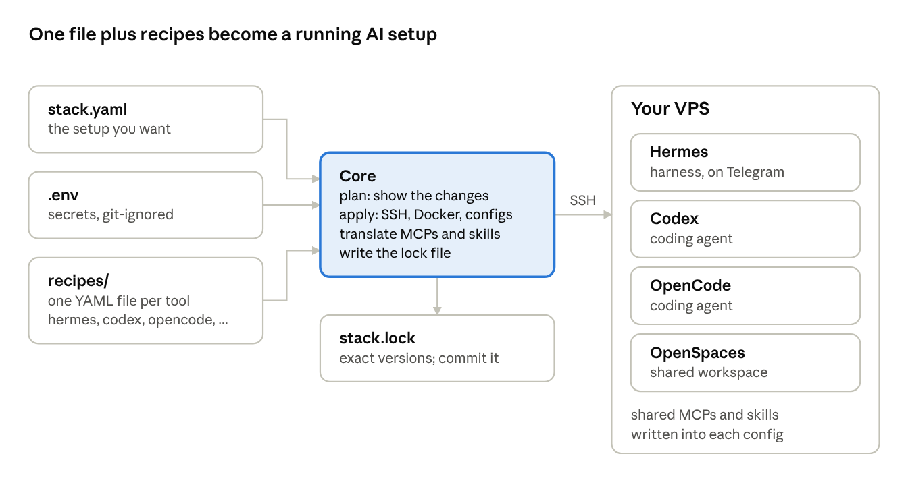

# Olympus — Design Doc

Oct 19, 2026 · @Devansh

An older live version is at https://claude.ai/code/artifact/ceba9b3f-01ae-4774-bcf0-740b16516722; this file is current and includes ADRs 0013–0016.

## Summary

Olympus turns one YAML file into a whole AI setup on a VPS: agents, coding agents, workspaces, their MCP servers, skills and chat channels, all connected. You run `apply`, and the server matches the file. A lock file makes it reproducible, the way Terraform and Nix are.

Its breadth comes from **recipes**: one small YAML file per tool (Hermes, OpenClaw, Claude Code, Codex, OpenCode, pi and so on). The core stays small; the recipe catalog grows.

## Problem

People now run several AI tools at once, not one. Setting them up on a VPS by hand takes days, and connecting them takes longer.

The target setup, from Haze's own use:

- **Hermes** as a personal agent, reachable on Telegram
- **Claude Code** and **Codex** running on the server as always-on coding agents
- **OpenSpaces** (or similar) as a shared workspace
- The same MCP servers and skills available to every agent
- All of it rebuilt on a new server from one file, and kept up to date

Each tool has its own install steps, ports and config format. Hermes puts MCP servers in `config.yaml`, Codex in `config.toml`, Claude Code in `.mcp.json`. One-click hosts set up a single agent; nothing sets up and connects the whole set.

## What already exists

No tool today sets up a mix of different agents from one declarative file. The closest projects each cover one slice.

| Project | What it does | What it lacks for this idea |
| --- | --- | --- |
| [aideploy](https://github.com/belongnet/aideploy) | Deploys OpenClaw or Hermes to your cloud via OpenTofu; fleet features on its paid service | Public CLI is DigitalOcean-only and beta; one agent type per deploy; no recipe catalog |
| [ClawHost](https://github.com/antoinersx/clawhost) | Open-source one-click hosting: Hetzner VPS, DNS, SSL, cloud-init (MIT) | One agent per server; a hosting dashboard, not a config file |
| [OpenClaw Launch](https://openclawlaunch.com/hermes-hosting), [MyClaw](https://myclaw.ai/), [Railway](https://railway.com/deploy/hermes) | Managed one-click hosting for single agents | Not reproducible from a file; you don't own the server |
| [Dokploy templates](https://dokploy.com/templates?tag=agents) | Self-hosted PaaS with Hermes and other agent templates | Apps run side by side but aren't connected; no shared MCPs or skills |
| [Pulumi OpenClaw guide](https://www.pulumi.com/blog/deploy-openclaw-aws-hetzner/) | Code that provisions a VM and installs one agent behind Tailscale | A blog example, not a tool |
| [Hermes NixOS module](https://hermes-agent.nousresearch.com/docs/getting-started/nix-setup), [openclaw-nix](https://discourse.nixos.org/t/openclaw-nix-hardened-nixos-flake-for-openclaw-deployment/75354) | Declarative, reproducible installs of one agent | Needs Nix knowledge; one module per agent, nothing connects them |
| [Orloj](https://www.orloj.dev/), [kagent](https://jimmysong.io/en/ai/kagent), [Docker cagent](https://docs.docker.com/ai/docker-agent/configuration/overview/) | Declarative agent definitions and orchestration | Define agent behaviour, not hosting; assume the infrastructure already exists |
| [OpenSpaces](https://github.com/Anil-matcha/open-spaces), [AgentTeams](https://github.com/agentscope-ai/AgentTeams) | Open-source workspaces where agents and people collaborate | Apps to deploy, not deployment tools; good recipe candidates |

The gap: **one file, many different tools, connected, reproducible**.

## Design

The tool has three layers: a small core, a catalog of recipes, and the user's stack file. Terraform and Nix work the same way; their cores know nothing about AWS or any app, and providers or packages supply that.



- **Stack file** (`stack.yaml`): what you want on the server, with MCP servers and skills defined once. Secrets are referenced as `${NAME}` and live in `.env`.
- **Recipes** (`recipes/<tool>/recipe.yaml`): declarative YAML with templates, one per tool. Each says how to install and run the tool, where its config lives, and how MCPs, skills and channels map into that config. An optional shell hook covers odd cases.
- **Core** (Go, one binary): works in two phases, taken from Nix flakes and Terraform.
    1. **Evaluate, on your machine.** Reads the stack file, the lock and the pinned recipes, and renders a *generation*: one Docker Compose file, each tool's native config files, and a manifest with a content hash per tool. Structured files are built as data and encoded, not text-templated. No server needed, and no secret values read.
    2. **Activate, on the server.** `plan` diffs the generation against the server's current one. `apply` uploads changed tool outputs to `/var/lib/olympus/store/<hash>/` and writes `generations/<n>/`. Then an activator on the server (the same binary, Linux build) writes secret files, runs `docker compose up` and runs health checks. It waits for the CLI to confirm over a fresh SSH connection, and rolls back by itself if no confirmation arrives in time. This "magic rollback" comes from deploy-rs.

v1 targets a server you already have, reached over SSH. Creating servers comes later. Decisions: [ADR 0013](../ADR.md#0013-write-olympus-in-go) (Go), [0014](../ADR.md#0014-evaluate-the-stack-locally-into-a-generation-then-activate-it-on-the-server) (generations), [0015](../ADR.md#0015-use-one-docker-compose-project-as-the-runtime) (Compose), [0016](../ADR.md#0016-pin-the-recipe-set-as-a-flake-style-input) (recipe input), [0017](../ADR.md#0017-activate-on-the-server-and-roll-back-unless-the-cli-confirms) (server-side activation with confirm-or-rollback), [0018](../ADR.md#0018-build-structured-config-as-data-and-publish-json-schemas) (structured config, JSON Schemas).

| Command | Inspired by | Does |
| --- | --- | --- |
| `check` | `nix flake check`, `helm lint` | Validates the stack and recipes against their JSON Schemas, offline |
| `build` | `nix build`, `helm template` | Renders the generation locally for inspection |
| `plan [-out file]` | `terraform plan` | Diffs the built generation against the server's current one |
| `apply [file]` | `terraform apply`, `deploy-rs` | Uploads, activates on the server, health-checks, confirms; the server rolls back without confirmation |
| `rollback` | `nixos-rebuild --rollback` | Switches back to the previous generation |
| `update` | `nix flake update` | Moves the recipe input and image digests in the lock to newer versions |
| `status` | | Shows each tool's container state and health |
| `gc` | `nix-collect-garbage` | Deletes generations beyond the last `keep` (default 5) and store entries no kept generation uses |
| `destroy` | `terraform destroy` | Removes the Compose project; keeps volumes unless told otherwise |

## Examples

Two files carry the whole idea: the stack file you write, and a recipe file per tool. Both are illustrative; real paths and ports get checked against each tool's docs while writing its recipe.

**Stack file** (`stack.yaml`, written by the user):

```yaml
inputs:
  recipes: github:haze/olympus/recipes   # pinned to a git revision in stack.lock

server:
  host: 1.2.3.4
  ssh_key: ~/.ssh/id_ed25519

mcps:                                  # defined once
  github:
    command: npx @modelcontextprotocol/server-github
    env: { GITHUB_TOKEN: ${GH_TOKEN} }

skills:
  - ./skills/deploy-checklist          # a SKILL.md folder

agents:
  hermes:
    recipe: hermes
    mcps: [github]
    skills: all
    channels:
      telegram: { token: ${TG_TOKEN}, allow: ["@haze"] }
  codex:
    recipe: codex
    mcps: [github]
  opencode:
    recipe: opencode
    mcps: [github]
    skills: all

apps:
  open-spaces:
    recipe: open-spaces
```

**Recipe file** (`recipes/hermes/recipe.yaml`, written once per tool):

```yaml
name: hermes
kind: harness
image: nousresearch/hermes-agent
resources: { min_ram: 4GB }
volumes:
  data: /opt/data                      # included in backups
health: { port: 8642, path: /health }
supports:
  mcps:     { file: /opt/data/config.yaml, format: yaml, key: mcp_servers }
  skills:   { dir: /opt/data/skills }
  channels: [telegram, discord]
templates:
  - config.yaml.tmpl -> /opt/data/config.yaml
hooks:
  post_install: hermes setup --non-interactive   # escape hatch for odd cases
```

The `supports` block is what lets the core write one `mcps` entry into Hermes's `config.yaml`, Codex's `config.toml` and OpenCode's `opencode.json`.

## Reproducible and maintainable

Committing `stack.yaml` and `stack.lock` to git gives anyone the same system on a new server.

- **Lock file.** Records the recipe input's git revision and content hash, and each tool's image digest. Later runs use those until you run `update`. Same idea as `flake.lock`.
- **Pure evaluation.** The same stack file, lock and recipes always render the same generation, with the same per-tool hashes. A tool restarts only when its hash changes.
- **Generations.** Each `apply` creates a numbered generation on the server; `rollback` returns to the previous one. The server's generations are the state, so there is no separate state file to lose.
- **Recipes are pinned as one input.** When a tool changes its port or config format, its recipe is fixed in the repo and users pick it up with `update`; the core doesn't change.
- **One official recipe folder.** All recipes live in `recipes/` in the tool's git repo, like Homebrew core and nixpkgs. That keeps them consistent and reviewable.

One limit: the file reproduces the *setup*, not the *state*. Agent memory, chat history and CLI logins live on the server and need backups.

## Security defaults

The safe setup is the default; loosening it takes an explicit line in the file. Exposed OpenClaw gateways with no auth have been found on Shodan ([Pulumi](https://www.pulumi.com/blog/deploy-openclaw-aws-hetzner/)), so this matters from day one.

- **Secrets never go in the YAML.** The file references `${NAME}`; values live in a git-ignored `.env`. On `apply`, each tool gets only its own secrets, in files only its user can read.
- **Nothing is exposed publicly.** Web UIs bind to localhost; you reach them through an SSH tunnel.
- **Chat channels are allow-listed.** A Telegram bot only answers the user IDs in `allow`.
- **Each tool runs in its own container**, so one compromised tool can't read another's files.
- **Subscription logins.** Check Anthropic's and OpenAI's terms before using a Claude or ChatGPT subscription in an always-on server setup; API keys are the safe default.

## v1 scope and build order

v1 = the core, the shared `mcps` and `skills` blocks, and recipes for the major agents, built in this order:

1. **Core on one server.** `check`, `build`, `plan`, `apply`, `status`, `rollback`, `gc` and `destroy`; local evaluation into generations, activation over SSH with Docker Compose, the lock file.
2. **Recipe format, tested on 3 different kinds of tool:** Hermes (harness with chat channels), Codex (coding agent) and OpenCode (open-source coding agent). Fix the format before writing more.
3. **Shared `mcps` and `skills` blocks**, translated into each recipe's native config.
4. **Channels** for harnesses: Telegram first, then Discord.
5. **The rest of the major tools as recipes:** Claude Code, Gemini CLI, OpenClaw, pi, oh-my-pi, Goose, Aider, Grok bot, then workspaces such as OpenSpaces.

**Not in v1:** creating servers, multiple servers, agent-to-agent delegation, the AI-sets-it-up MCP mode, recipes from outside git repos, shared memory, backups, orchestration. All are listed under *Future*.

## Open questions

- [ ] Which chat channels each harness supports, and how channel config looks in the stack file
- [ ] Exact meaning of "pi" and "omp" in the recipe list (assumed: pi coding agent and oh-my-pi)
- [ ] How Claude Code and Codex logins are handled headless (token step, API keys) and what the providers' terms allow
- [ ] Template language for recipes: Go `text/template` (likely, since the core is Go), or plain `${var}` substitution
- [ ] Whether skills are copied into each tool or mounted from one shared folder

## Future: everything we can add

Everything below stays out of v1. Suggested next: agent-to-agent delegation (v2), then the AI-sets-it-up mode (v3); the rest is a backlog to pick from.

| Area | Idea | What it adds | When |
| --- | --- | --- | --- |
| Wiring | Agent-to-agent delegation | Hermes hands coding tasks to Codex (`codex mcp-server`) or Claude Code (a wrapper around headless `claude -p`) | v2 |
| Wiring | Shared folder | One `/shared` folder every agent can read and write | v2 |
| Wiring | Shared memory service | An MCP memory server or Postgres with vector search that agents query | Later |
| Wiring | Agents inside workspaces | Agents appear as participants in OpenSpaces or AgentTeams | Later |
| Wiring | Model gateway | One place for model keys, spend limits and fallbacks (LiteLLM or similar) | Later |
| Wiring | Orchestration | Manager and worker agents, task routing, policies | Later |
| AI-operated | MCP mode for the tool | Agents call `validate`, `plan`, `status`, `logs`; `apply` needs human approval; agents never see secret values | v3 |
| AI-operated | Read-only access for on-server agents | Hermes can check status and logs of its own server but not change it | v3 |
| Infrastructure | Create servers | Provision Hetzner, DigitalOcean or AWS servers through OpenTofu before setup | Later |
| Infrastructure | Multiple servers | One file places agents across several machines | Later |
| Infrastructure | Private network and domains | Tailscale, custom domains and HTTPS for web UIs | Later |
| Infrastructure | Local models | Ollama or vLLM recipes on GPU servers, so agents can skip paid APIs | Later |
| Infrastructure | Scale inside one system | `count: 3` to run several workers of the same agent | Later |
| Infrastructure | Other targets | Generate a NixOS module, a Helm chart or kagent resources from the same file | Later |
| Operations | Backup and restore | Copy agent memory, logins and shared files to a laptop or S3, on demand or on a schedule | Later |
| Operations | Rollback past garbage collection | Restore a generation that `gc` already deleted, from `stack.lock` history in git | Later |
| Operations | Doctor | Health checks and fixes for common problems | Later |
| Operations | Drift repair | `plan` already shows hand-made changes; offer to adopt them back into `stack.yaml` | Later |
| Operations | Cost tracking | Server cost plus token spend per agent | Later |
| Operations | Observability | Traces of agent runs via OpenTelemetry | Later |
| Secrets | Encrypted secrets in git | sops and age, so the whole setup lives in one repo | Later |
| Secrets | Password manager integration | Pull secrets from 1Password or Bitwarden CLI | Later |
| Secrets | Rotation | Rotate API keys and tokens with one command | Later |
| Ecosystem | Recipes from any git URL | Third parties publish recipes without asking, like Terraform modules | Later |
| Ecosystem | Recipe CI | Test every recipe nightly to catch upstream breaks early | Later |
| Ecosystem | Stack presets | Ready-made bundles, such as a "solo dev stack" or a "research stack" | Later |
| Ecosystem | Version bot | Automatic pull requests when a new agent version ships | Later |
| Ecosystem | Import | Generate a `stack.yaml` from an existing server | Later |
| Ecosystem | External services | Reference hosted tools (Muse, Grok, ChatGPT) where they offer an API | Later |
| Interfaces | Terminal UI or web dashboard | See and manage the stack without editing YAML | Later |
| Interfaces | Terraform provider or Pulumi package | Use it from existing infrastructure code | Later |
| Interfaces | Hosted version | A paid managed service for non-technical users | Later |
| Interfaces | Team stacks | Give every teammate the same set of agents | Later |

## Learning resources

Start with the Terraform tutorials and cloud-init; those two cover most of what v1 does.

| Topic | Resource | Why |
| --- | --- | --- |
| Terraform | [HashiCorp tutorials](https://developer.hashicorp.com/terraform/tutorials) | Hands-on basics: plan, apply, state |
| Terraform | *Terraform: Up & Running*, Yevgeniy Brikman (3rd ed.) | Best book on state, modules and team use |
| Terraform | [OpenTofu docs](https://opentofu.org/docs/) | The open-source fork you would build on |
| Terraform | [Plugin framework](https://developer.hashicorp.com/terraform/plugin/framework) | How providers are written; useful model for recipes |
| IaC in code | [Pulumi docs](https://www.pulumi.com/docs/) | Infrastructure in TypeScript or Python |
| Server setup | [cloud-init docs](https://cloudinit.readthedocs.io/) | How servers configure themselves on first boot |
| Containers | [Docker Compose docs](https://docs.docker.com/compose/) | How the apps will run on the server |
| Deploy tools | [Kamal](https://kamal-deploy.org/) | A small SSH-based deploy tool worth copying ideas from |
| Networking | [Tailscale docs](https://tailscale.com/kb) | Private access between machines |
| Basics | [roadmap.sh/devops](https://roadmap.sh/devops), [The Twelve-Factor App](https://12factor.net/) | What to learn, in what order; rules for running apps |
| Nix | [Zero to Nix](https://zero-to-nix.com/), then [nix.dev](https://nix.dev/) | Where the reproducibility ideas come from |
| Prior art | [ClawHost](https://github.com/antoinersx/clawhost), [aideploy](https://github.com/belongnet/aideploy) | Closest existing code to read |
| Agent configs | [Hermes MCP docs](https://hermes-agent.nousresearch.com/docs/user-guide/features/mcp), [Codex MCP server](https://mintlify.com/openai/codex/cli/mcp-server) | How the first recipes wire up MCP |
